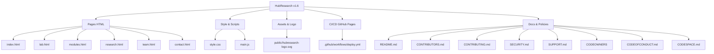
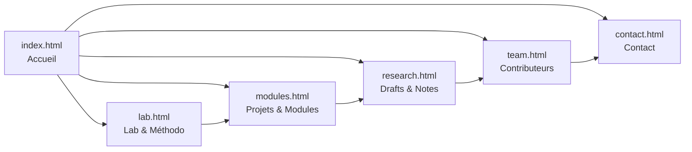
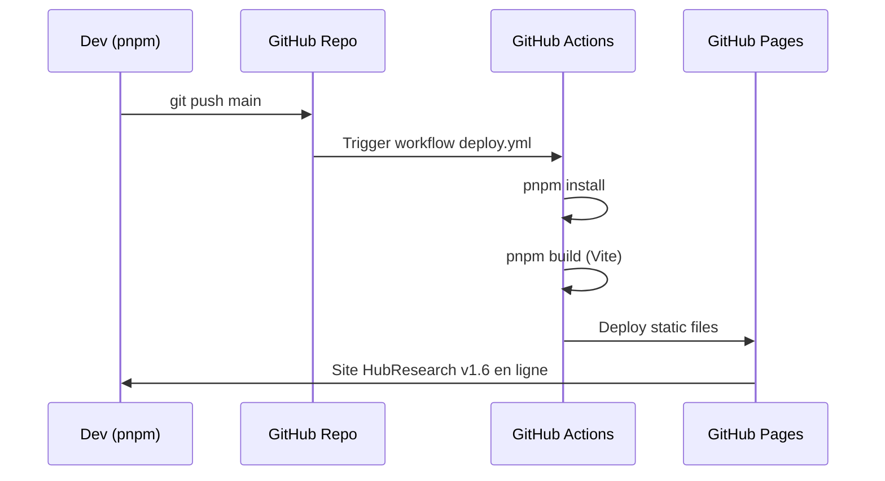
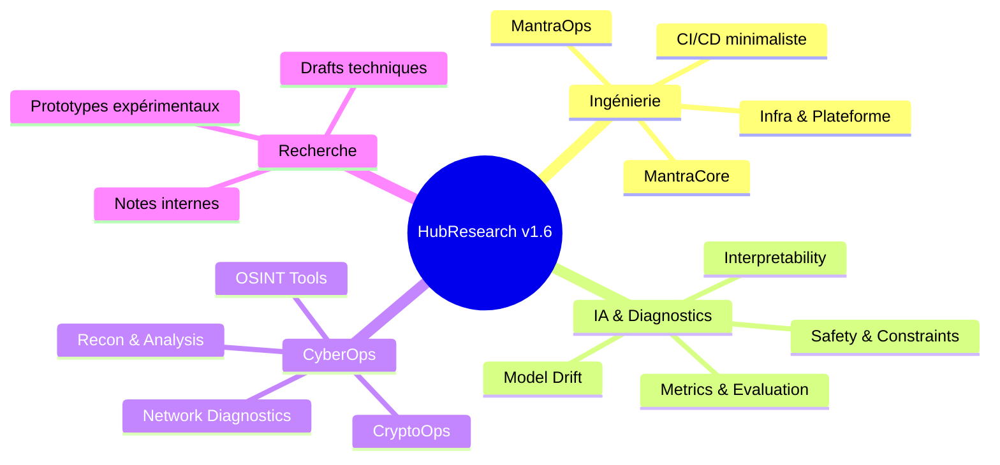
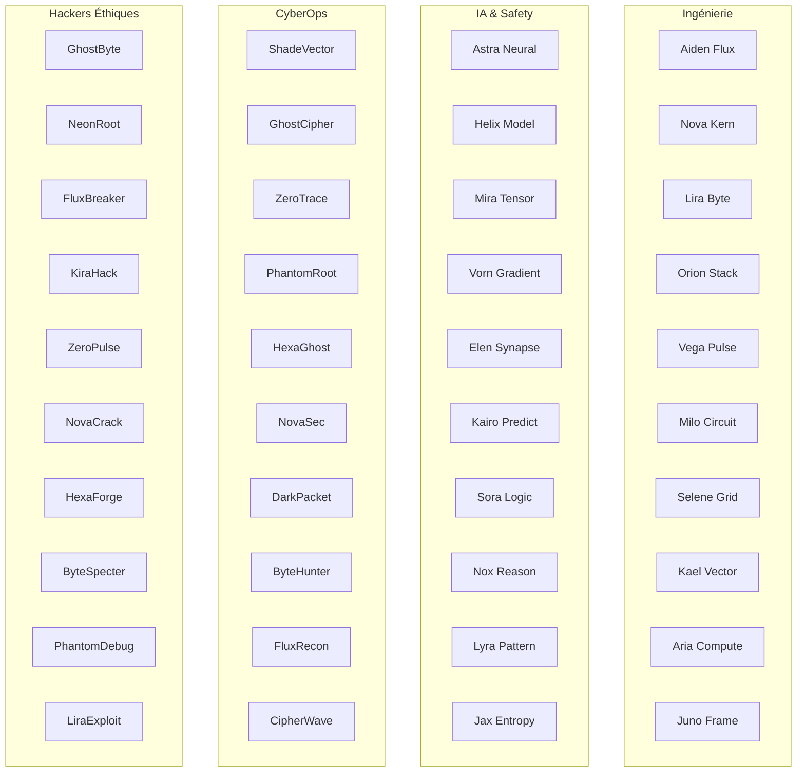
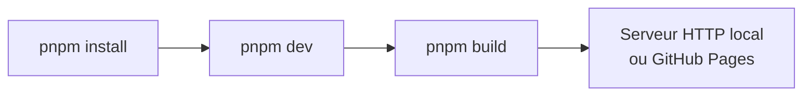
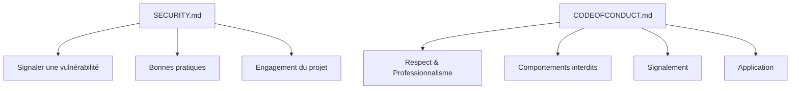
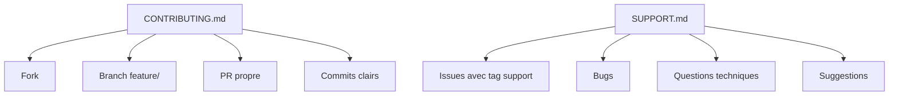
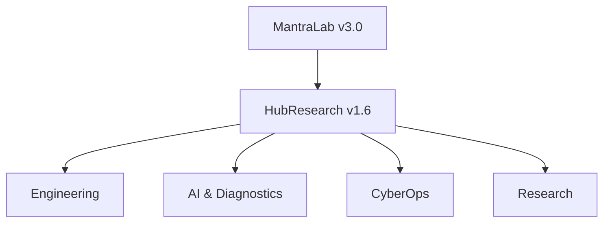

# HubResearch v1.6
- — Diagrammes Mermaid

Portail d’ingénierie, d’IA et de cyber‑ops du MantraLab v3.0, présenté principalement via des diagrammes Mermaid.

---

🧩 Vue d’ensemble du projet



---

🧭 Architecture des pages



---

🛠️ Pipeline CI/CD GitHub Pages



---

🧠 Modules logiques (Ingénierie, IA, Cyber‑Ops)



---

👥 Contributeurs (68 avatars GitHub)



> Les avatars sont générés automatiquement via GitHub :  
> https://avatars.githubusercontent.com/u/10000001 → https://avatars.githubusercontent.com/u/10000068

---

⚙️ Commandes principales



---

🔐 Sécurité & Conduite



---

🤝 Contribution & Support



---

🧭 Codespaces & Ownership

```mermaid
flowchart TD
    Codespace[CODESPACE.md] --> CS1[Node 18+]
    Codespace --> CS2[pnpm]
    Codespace --> CS3[Extensions recommandées]

    Owners[CODEOWNERS] --> O1[@teremuhamblin]
    Owners --> O2[/src/]
    Owners --> O3[/public/]
    Owners --> O4[.github/workflows/]
```

---

🛰️ MantraLab v3.0 — HubResearch v1.6



---

> HubResearch v1.6  
> Engineering the Future. Exploring Intelligence. Building Cyber‑Ops.

`md
`
