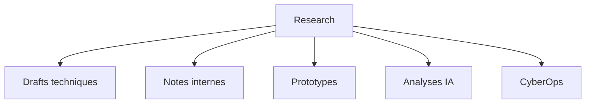
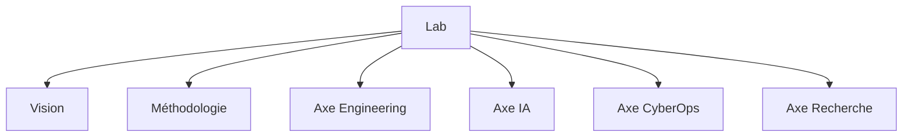
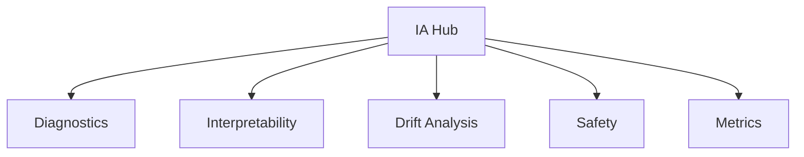

## 📚 Documentation
- HubResearch v1.6

📁 Structure générées

>> **~/docs/HubResearch.md** (documentation complète)
- *sur la recherche*  
- *sur le Lab, la vision et la méthodologie*. 
- sur IA : *diagnostics, interpretability, safety, metrics*.  

---

📘 1. Research — v1.6
- documentation Recherche

🎯 Objectif
La section *Research du HubResearch* centralise :
- les drafts techniques,
- les notes internes,
- les prototypes expérimentaux,
- les analyses IA et CyberOps,
- les documents d’ingénierie avancée.

*Elle sert de base à la production scientifique et technique du MantraLab v3.0*.

---

🧩 Structure de la Recherche



---

📄 Types de documents

1. Drafts techniques
Documents en cours de rédaction :
- analyses IA,
- pipelines CI/CD,
- modules CyberOps,
- architectures système.

2. Notes internes
Courtes notes d’ingénierie :
- décisions techniques,
- choix d’architecture,
- tests rapides,
- retours d’expérience.

3. Prototypes
Mini‑modules expérimentaux :
- IA WebGPU,
- scanners réseau JS,
- dashboards interactifs.

---

🧪 Méthodologie de recherche

- Approche modulaire  
- Documentation systématique  
- Tests reproductibles  
- Versioning strict  
- Transparence des résultats  

---

📊 Format recommandé

```md

HR-<TYPE>-<ID> — Titre

Objectif

Contexte

Méthodologie

Résultats

Analyse

Prochaines étapes
```

---

🚀 Roadmap Recherche v1.7

- IA WebGPU live  
- CyberOps JS live  
- Dashboard interactif  
- Système de logs client/server  
`

---

📘 2. Lab.md — documentation Lab

🧭 Vision du MantraLab v3.0
Le Lab est le cœur stratégique du HubResearch.  
Il définit *la vision, la méthodologie, les axes de recherche et les standards d’ingénierie*.

---

🎯 Objectifs du Lab
```text
- Construire des systèmes robustes et scalables  
- Rendre les modèles IA interprétables  
- Intégrer la cyber‑sécurité dès la conception  
- Documenter chaque étape du cycle de vie  
- Favoriser la recherche ouverte et responsable  
```

---

🧩 Architecture du Lab



---

🧠 Méthodologie

1. Ingénierie
- Architecture modulaire  
- Pipelines CI/CD minimalistes  
- Observabilité intégrée  
- Documentation systématique  

2. IA
- Interpretability  
- Drift analysis  
- Safety constraints  
- Metrics & evaluation  

3. CyberOps
- OSINT  
- Recon  
- CryptoOps  
- Network diagnostics  

---

📄 Standards du Lab

- Code propre, lisible, documenté  
- Pas de dépendances lourdes  
- Tests systématiques  
- Sécurité intégrée  
- Transparence des décisions  

---

🚀 Roadmap Lab v1.7

- Mode dark avancé  
- Documentation interactive  
- Modules IA live  
- Modules CyberOps live  

---

📘 3. ai.md — documentation IA

🧠 Objectif
```text
La section IA du HubResearch couvre :
- diagnostics de modèles,
- interpretability,
- drift analysis,
- safety constraints,
- metrics & evaluation.
```

---

🧩 Architecture IA



---

🔬 Diagnostics IA

Objectifs
- détecter les anomalies,
- analyser les comportements,
- mesurer la robustesse.

Méthodes
- tests de stabilité,
- analyse de gradients,
- stress tests.

---

🧠 Interpretability

Techniques
- SHAP  
- LIME  
- Feature importance  
- Attention maps  

Objectifs
- comprendre les décisions du modèle  
- identifier les biais  
- améliorer la transparence  

---

📉 Drift Analysis

Types de drift
- Data drift  
- Concept drift  
- Feature drift  

Méthodes
- comparaison de distributions  
- monitoring continu  
- alertes automatiques  

---

🛡️ Safety & Constraints

Objectifs
- éviter les comportements dangereux  
- limiter les dérives  
- garantir la conformité  

Méthodes
- règles de sécurité  
- contraintes logiques  
- filtres de sortie  

---

📊 Metrics & Evaluation

Types de métriques
- précision  
- recall  
- F1  
- perplexité  
- robustesse  
- stabilité  

---

🚀 Roadmap IA v1.7

- IA WebGPU live  
- Dashboard IA interactif  
- Analyse de drift en temps réel  
- Safety dynamique  
`

---
